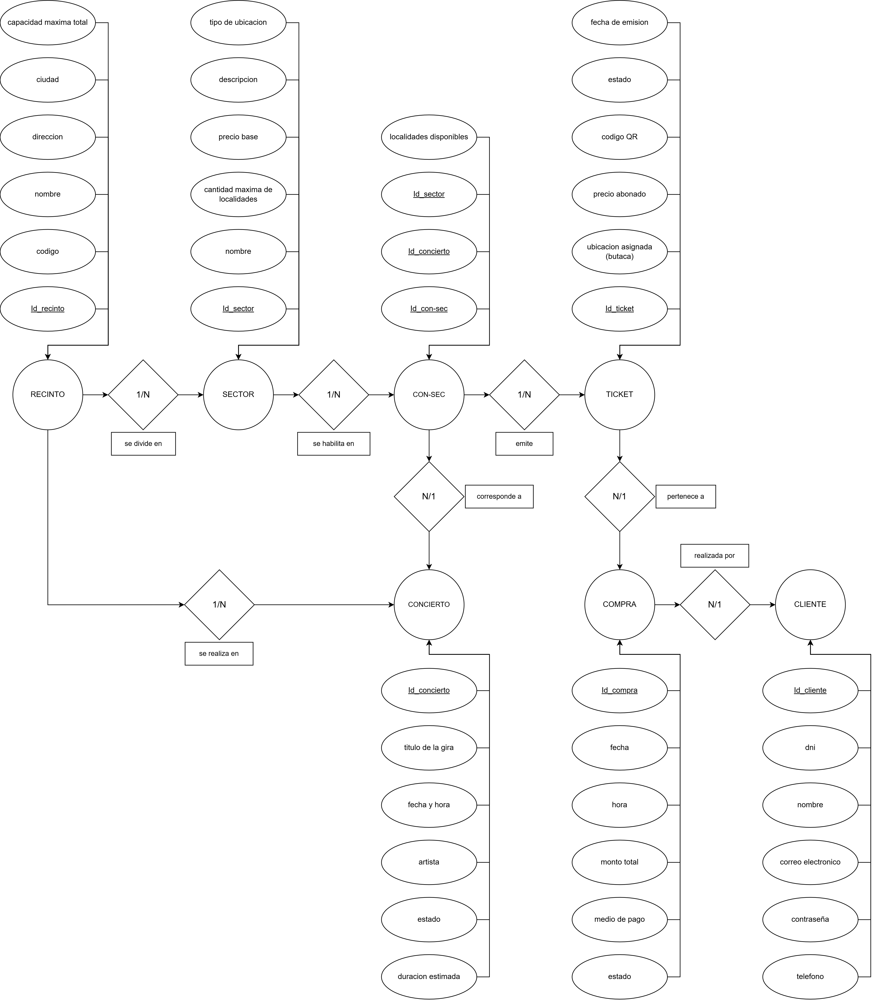

# BASE DE DATOS — Ejercicio 11: Sistema de Gestión de Conciertos y Venta de Entradas (Ticketing)

Trabajo práctico de Base de Datos (Universidad Champagnat). Este repositorio contiene todo el desarrollo del ejercicio 11: modelo entidad-relación, modelo relacional y normalización (1FN, 2FN y 3FN).

## Consigna


#### Contexto

Una productora de espectáculos musicales masivos requiere un sistema informático para gestionar la programación de recitales, la asignación de recintos (estadios, arenas, teatros), la distribución de sectores y la comercialización online de entradas para los fanáticos.


#### Consigna

Diseñar el modelo entidad-relación que permita administrar los conciertos, los recintos, la sectorización de los espacios y la venta de tickets, considerando las siguientes reglas de negocio:

Un recinto se identifica por su código, nombre, dirección, ciudad y capacidad máxima total.

Un recinto se divide en múltiples sectores (ej. Campo delantero, Platea Baja, Tribuna Popular). Cada sector posee un nombre distintivo, la cantidad máxima de localidades disponibles y el precio base del ticket para ese sector.

Los conciertos se identifican por un ID de evento, título de la gira, fecha y hora de realización, y el recinto donde se llevará a cabo. Un recinto puede albergar múltiples conciertos a lo largo del tiempo, pero un concierto ocurre en un único recinto.

Los clientes se registran aportando su DNI, nombre, correo electrónico y contraseña. Un cliente puede realizar múltiples compras de entradas.

Una compra de entradas genera una transacción única (orden de compra) con su fecha, hora y monto total. En dicha compra se adquieren uno o más tickets. Cada ticket emitido está asociado a un concierto, un sector específico del recinto y un cliente comprador, asegurando la trazabilidad de la butaca o lugar asignado.


#### Desarrollo requerido


Analizar las entidades principales (Recinto, Sector, Concierto, Cliente, Compra, Ticket) y definir sus atributos atómicos.

Establecer la relación jerárquica o de dependencia entre Recinto y sus Sectores.

Modelar la asociación entre Concierto, Recinto y Sector para determinar la disponibilidad de localidades.

Definir la estructura de la Compra y los Tickets individuales, especificando las cardinalidades correspondientes.

## Estructura del repositorio

```
BASE_DE_DATOS_Ejercicio_11/
├── README.md
├── modelo-er/
│   ├── ejercicio_11.drawio        # diagrama editable (draw.io)
│   └── ejercicio_11.png           # exportación del diagrama
├── modelo-relacional/
│   ├── ejercicio_11_MR.xlsx               # modelo relacional
│   └── ejercicio_11_con_datos.xlsx        # modelo relacional con datos de ejemplo
└── normalizacion/
    ├── ejercicio_11_1FN.xlsx
    ├── ejercicio_11_2FN.xlsx
    └── ejercicio_11_3FN.xlsx
```

## Modelo entidad-relación



Archivo editable: [`modelo-er/ejercicio_11.drawio`](modelo-er/ejercicio_11.drawio).

## Modelo relacional

Tablas del modelo relacional original, antes de normalizar (`(PK)` clave primaria, `(FK)` clave foránea, `(UNIQUE)` valor único):

- **RECINTO**: `Id_recinto(PK)`, `codigo(UNIQUE)`, `nombre`, `direccion`, `ciudad`, `capacidad maxima total`
- **SECTOR**: `Id_sector(PK)`, `nombre`, `cantidad maxima de localidades`, `precio base`, `descripcion`, `tipo de ubicacion`, `Id_recinto(FK)`
- **CONCIERTO**: `Id_concierto(PK)`, `titulo de la gira`, `fecha y hora`, `artista`, `estado`, `duracion estimada`, `Id_recinto(FK)`
- **CON-SEC**: `Id_con-sec(PK)`, `Id_concierto(FK, PK)`, `Id_sector(FK, PK)`, `localidades disponibles`
- **CLIENTE**: `Id_cliente(PK)`, `dni(UNIQUE)`, `nombre`, `correo electronico(UNIQUE)`, `contraseña`, `telefono`
- **COMPRA**: `Id_compra(PK)`, `fecha`, `hora`, `monto total`, `medio de pago`, `estado`, `Id_cliente(FK)`
- **TICKET**: `Id_ticket(PK)`, `ubicacion asignada (butaca)`, `precio abonado`, `codigo QR(UNIQUE)`, `estado`, `fecha de emision`, `Id_con-sec(FK)`, `Id_compra(FK)`

Archivos: [`ejercicio_11_MR.xlsx`](modelo-relacional/ejercicio_11_MR.xlsx) y [`ejercicio_11_con_datos.xlsx`](modelo-relacional/ejercicio_11_con_datos.xlsx).

## Lógica relacional

Cada entidad se convierte en una tabla con su clave primaria. Las relaciones se representan así:

- **1:N / N:1**: la clave primaria del lado "uno" se copia como clave foránea (FK) en la tabla del lado "muchos".
- **1:1**: igual que 1:N, pero la FK lleva restricción UNIQUE.
- **N:M**: se crea una tabla intermedia cuyas FK forman una clave compuesta, junto con una clave propia que se identifica por esa combinación.

Relaciones del modelo final (3FN):

- `SECTOR` → `RECINTO`: **N:1** (FK `id_recinto` en `SECTOR`).
- `CONCIERTO` → `RECINTO`: **N:1** (FK `id_recinto` en `CONCIERTO`).
- `CONCIERTO` ↔ `SECTOR`: relación **N:M**, resuelta con la tabla intermedia `CON-SEC` (sus FK forman la clave compuesta única).
- `COMPRA` → `CLIENTE`: **N:1** (FK `id_cliente` en `COMPRA`).
- `TICKET` → `CON-SEC`: **N:1** (FK `id_con-sec` en `TICKET`).
- `TICKET` → `COMPRA`: **N:1** (FK `id_compra` en `TICKET`).

## Normalización

Los cambios se muestran etapa por etapa; cada etapa parte del resultado de la anterior.

### Primera forma normal (1FN)

- `RECINTO`: se quitan `direccion`
- `RECINTO`: se agregan `calle`, `numero`
- `TICKET`: se quitan `ubicacion asignada`
- `TICKET`: se agregan `fila o zona`, `asiento`

### Segunda forma normal (2FN)

Sin cambios respecto de la etapa anterior: el modelo ya cumplía esta forma normal.

### Tercera forma normal (3FN)

- `RECINTO`: se quitan `capacidad maxima total`
- `CON-SEC`: se quitan `localidades disponibles`
- `COMPRA`: se quitan `monto total`

#### Modelo final en 3FN

- **RECINTO**: `Id_recinto(PK)`, `codigo(UNIQUE)`, `nombre`, `calle`, `numero`, `ciudad`
- **SECTOR**: `Id_sector(PK)`, `nombre`, `cantidad maxima de localidades`, `precio base`, `descripcion`, `tipo de ubicacion`, `Id_recinto(FK)`
- **CONCIERTO**: `Id_concierto(PK)`, `titulo de la gira`, `fecha y hora`, `artista`, `estado`, `duracion estimada`, `Id_recinto(FK)`
- **CON-SEC**: `Id_con-sec(PK)`, `Id_concierto(FK, PK)`, `Id_sector(FK, PK)`
- **CLIENTE**: `Id_cliente(PK)`, `dni(UNIQUE)`, `nombre`, `correo electronico(UNIQUE)`, `contraseña`, `telefono`
- **COMPRA**: `Id_compra(PK)`, `fecha`, `hora`, `medio de pago`, `estado`, `Id_cliente(FK)`
- **TICKET**: `Id_ticket(PK)`, `fila o zona`, `asiento`, `precio abonado`, `codigo QR(UNIQUE)`, `estado`, `fecha de emision`, `Id_con-sec(FK)`, `Id_compra(FK)`

Archivos: [`ejercicio_11_1FN.xlsx`](normalizacion/ejercicio_11_1FN.xlsx), [`ejercicio_11_2FN.xlsx`](normalizacion/ejercicio_11_2FN.xlsx), [`ejercicio_11_3FN.xlsx`](normalizacion/ejercicio_11_3FN.xlsx).
